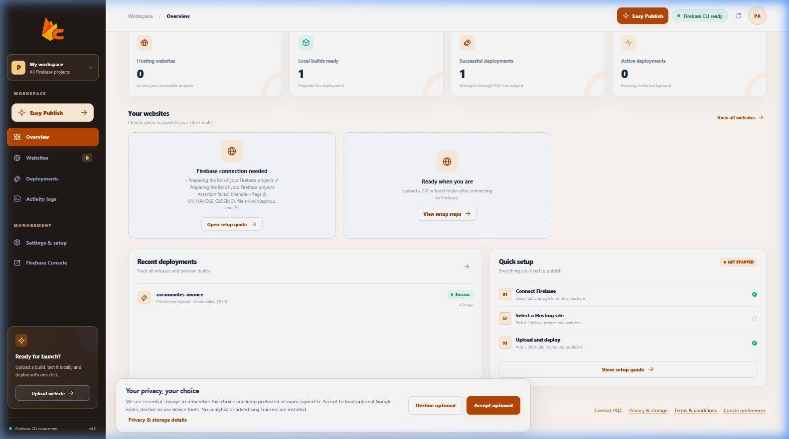
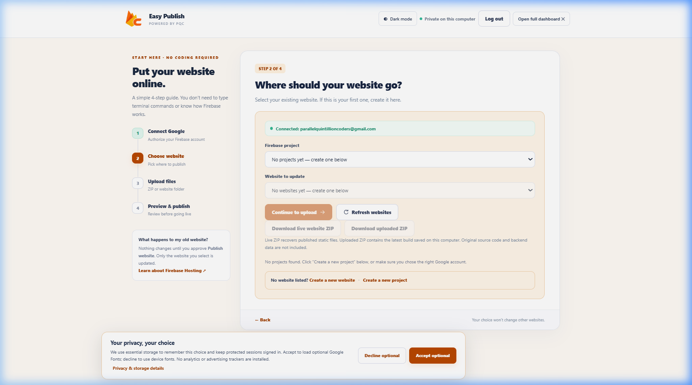
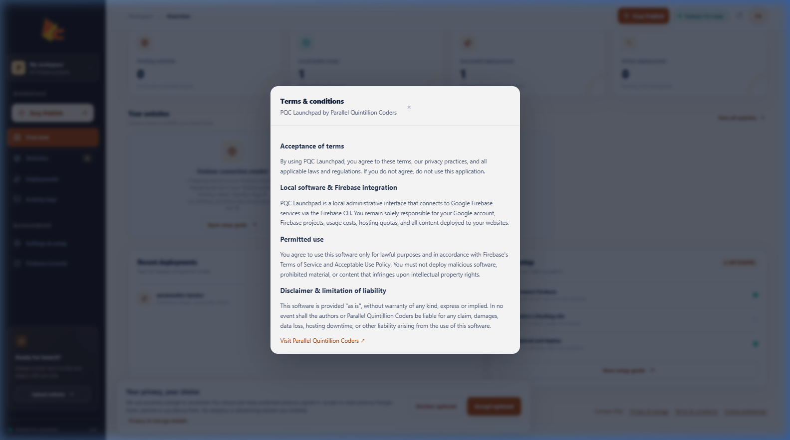

# Firebase Control Panel (PQC Launchpad) v4

> **Modern, cPanel-style dashboard for classic Firebase Hosting with a zero-terminal 4-step Easy Publish wizard.**

---

## 📸 Preview

### Modern Overview & Website Manager


### 4-Step Easy Publish Wizard (No Coding Required)


### Terms & Conditions & Privacy Modal


---

## 🚀 Quick Start (Zero Setup Needed)

| OS | How to Launch |
| :--- | :--- |
| **Windows** | Double-click **`START-HERE.bat`** |
| **macOS** | Double-click **`START-HERE-MAC.command`** (or `start-mac.command`) |
| **Linux** | Run **`./start-linux.sh`** |

*All launchers auto-install dependencies locally, check Node.js, and open **http://127.0.0.1:4183** in your browser automatically.*

---

## ✨ Features

- **No CLI / Coding Required**: Guided 4-step wizard to connect Google, pick a site, upload built files, and deploy to production.
- **Cross-Platform Launchers**: Native one-click scripts for Windows (`.bat`), macOS (`.command`), and Linux (`.sh`).
- **Live Site Quick Launch**: Native 1-click external link opens your live site directly with HTTPS.
- **One-Click Backup Downloads**: Download your active live site static files or your staged build as a verified ZIP.
- **Appearance & Themes**: Choose between **Flame** (warm orange) and **Classic** (purple) themes, with independent **Dark / Light mode**.
- **8 Languages**: Full local translation support for English, Spanish, Russian, French, German, Portuguese, Arabic (RTL), and Simplified Chinese.
- **Privacy & Security**: All operations and builds stay local on your machine. Includes transparent **Terms & Conditions** and **Privacy & Local Storage** documentation.

---

## 🛠️ CLI Commands

For developers who prefer terminal workflows:

```bash
# Check runtime health & syntax
npm run check

# Run tests
npm test

# Start local server manually
npm start
```

*See [CLI.md](CLI.md) for full command-line reference (`npm run panel`, `upload`, `deploy`, `logs`).*

---

## 📄 License & Credits

Built by [Parallel Quintillion Coders](https://parallelquintillioncoders.com/). Designed for classic Firebase Hosting.
